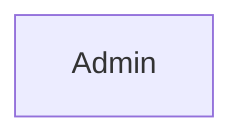
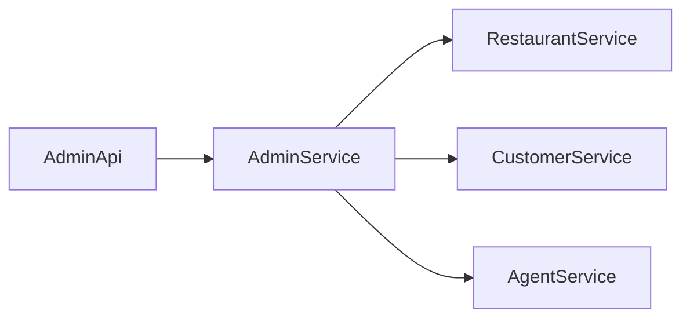

# Admin Service

Admin profile and menu/order operations. Port **8085**, MySQL database `admin`. Eureka name `ADMIN-SERVICE`.

## What it does

Saves an admin row, then creates or deletes restaurants and food by calling Restaurant Service. It also reads orders and agents from the other services.

## Request & Authentication

- Gateway prefix `/api/admin`, controller base `/admin`.
- `SecurityConfig` is `permitAll`. This service never reads the JWT.
- Gateway requires `ROLE_ADMIN`, except public `POST /api/admin/admin` (used by Auth during registration).
- Endpoints: create admin, create restaurant, create food, list orders, list agents, delete food, delete restaurant.
- There is no approve-agent endpoint.

## Service Communication

Load-balanced `RestClient`:

- `POST/DELETE http://RESTAURANT-SERVICE/restaurant` and `/fooditem`
- `GET http://CUSTOMER-SERVICE/orders/all?page=`
- `GET http://AGENT-SERVICE/agents/all?page=`

## Entity Map

`Admin` stores `userId` and `email` from Auth Service. Restaurants, orders, and agents are not stored here.

## Flow Diagram

