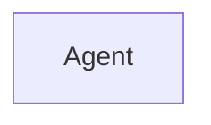
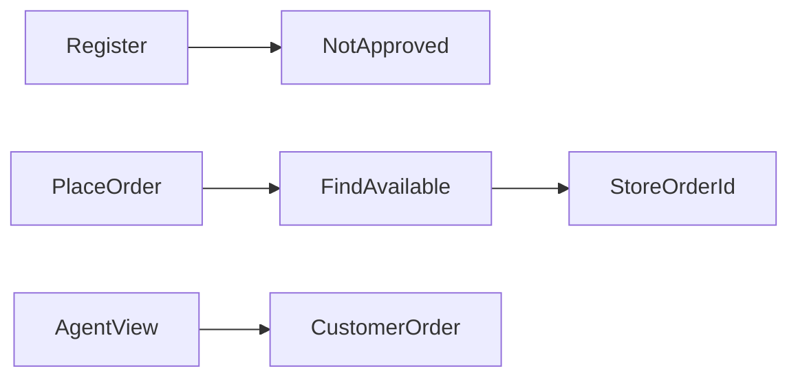

# Agent Service

Delivery agents. Port **8084**, MySQL database `agent`. Eureka name `AGENT-SERVICE`.

## What it does

Stores an agent application and, when Customer Service places an order, attaches that order id to one available agent.

## Request & Authentication

- Gateway prefix `/api/agent`, controller base `/agent`.
- No Spring Security filter. Gateway allows `AGENT` or `ADMIN`, except public `POST /agent`.
- `isAgentApproved`, `assignedorder`, and `update-order-status` read the email from the JWT.
- `POST /agent` (create) and `POST /assign-order` do not read the token.
- New agents are saved as `isApproved=false` and `NOT_APPROVED`.
- Assignment picks the first agent with status `AVAILABLE` and a null `orderId`.

## Service Communication

Load-balanced `RestClient` to Customer Service:

- `GET /orders/id?id=` for the assigned order
- `GET /deliveried?id=` when the agent marks delivery (see issues)

Auth Service calls `POST /agent` on register. Admin Service tries to list agents.

## Entity Map

`Agent.orderId` points at an order in Customer Service. It is not a JPA relation.

## Flow Diagram

