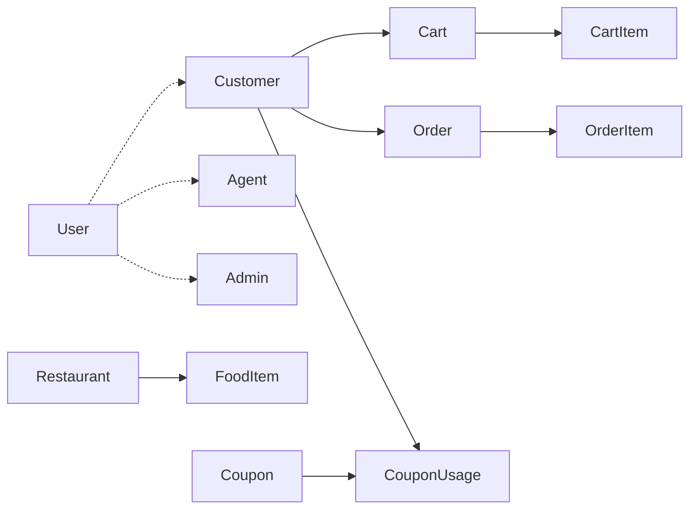

# Food Delivery Microservices

Frontends on `5173`, `5174`, and `5175` call only the API Gateway. Each service has its own MySQL database.

## Architecture

- **Eureka (**`8761`**)** is the registry. Services call each other with a `@LoadBalanced` `RestClient` and a name such as `http://RESTAURANT-SERVICE`.
- **Gateway (**`8080`**, folder** `apigateway`**)** checks the JWT role and proxies to fixed `localhost` ports. It does not route through Eureka. `StripPrefix=2` turns `/api/customer/cart` into `/cart`.
- **Auth (**`8081`**)** stores users and issues the JWT.
- **Restaurant (**`8082`**)** stores restaurants and food.
- **Customer (**`8083`**)** stores the customer profile, cart, coupons, and orders.
- **Agent (**`8084`**)** stores delivery agents and an assigned `orderId`.
- **Admin (**`8085`**)** creates the menu and reads orders and agents by calling the other services.

## JWT

`POST /api/auth/login` checks BCrypt and returns a token: subject = email, claims `userId` and `userType`, 24 hours. The gateway filter maps that to `ROLE_CUSTOMER`, `ROLE_AGENT`, or `ROLE_ADMIN`. Customer and Agent read the same header again when they need the email. Restaurant and Admin do not. Logout does not revoke the token.

## Main flows

- **Customer:** public menu → cart for one restaurant → `POST /orders?code=` prices the cart, applies the coupon, saves the order, clears the cart, calls Agent `assign-order`.
- **Restaurant:** public list/search. Admin creates and deletes rows through Admin Service.
- **Agent:** register starts as `NOT_APPROVED`. Assignment needs status `AVAILABLE` and no current order. The agent then loads that order from Customer Service.
- **Admin:** register as `ADMIN`, then add or delete restaurants and food, and list orders and agents.

## Entities
Dotted lines are ids across databases, not JPA joins.

