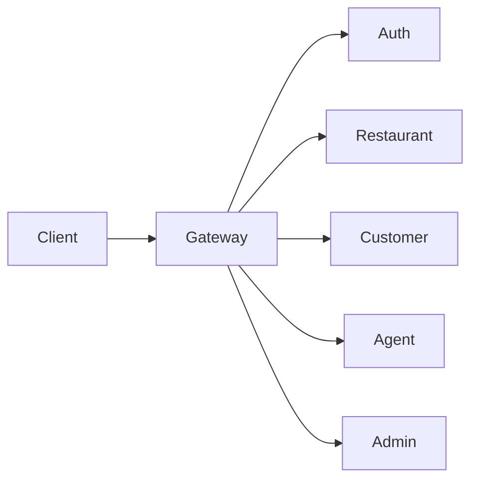
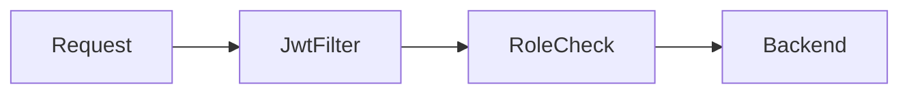

# API Gateway

Single entry for the frontends. Module folder is `apigateway`, port **8080**.

## What it does

Checks the JWT role, applies CORS for `5173` / `5174` / `5175`, then forwards the request. `StripPrefix=2` removes `/api/{name}`, so `/api/customer/cart` arrives as `/cart`.

## Request & Authentication

- Frontends call this service. It does not call the others.
- `JwtAuthenticationWebFilter` reads `Authorization: Bearer`.
- A valid token supplies the email and `ROLE_` plus `userType` (`CUSTOMER`, `AGENT`, `ADMIN`).
- Public: `/api/auth/**`, `POST /api/customer/customer`, `POST /api/agent/agent`, `POST /api/admin/admin`, and every non-POST under `/api/restaurant/**`.
- `POST /api/restaurant/**` requires `ROLE_ADMIN`.
- Other `/api/customer/**` routes require `CUSTOMER` or `ADMIN`.
- Other `/api/agent/**` routes require `AGENT` or `ADMIN`.
- Other `/api/admin/**` routes require `ADMIN`.
- Routes use fixed localhost URLs (`8081`–`8085`), not Eureka.

## Entity Map

No database.

## Flow Diagram

