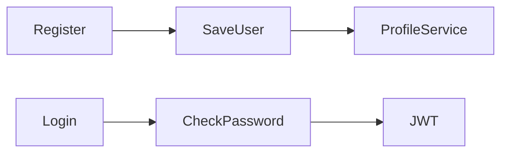

# Auth Service

Users, passwords, and JWT. Port **8081**, MySQL database `auth`. Eureka name `AUTH-SERVICE`.

## What it does

Registers a user, creates the matching profile in another service, and logs the user in. One `users` table holds every role.

## Request & Authentication

- Browser path: `/api/auth/register`, `/api/auth/login`, `/api/auth/logout`. Gateway strips the prefix, so this service sees `/register`, `/login`, `/logout`.
- Gateway allows all `/api/auth/**`. This service also permits those three paths.
- `JwtAuthenticationFilter` can read a Bearer token into `ROLE_{userType}`, but no business endpoint requires it.
- Passwords are stored with BCrypt. Login checks the hash and returns a token.
- Token claims: subject = email, `userId`, `userType`, expiry 24 hours (`jwt.expiration`).
- `logout()` is empty. The token stays valid until it expires.

## Service Communication

Load-balanced `RestClient` (Eureka), after the user row is saved:

- `CUSTOMER` → `POST http://CUSTOMER-SERVICE/customer`
- `AGENT` → `POST http://AGENT-SERVICE/agent`
- `ADMIN` → `POST http://ADMIN-SERVICE/admin`

The caller chooses `userType` in the register body.

## Flow Diagram

