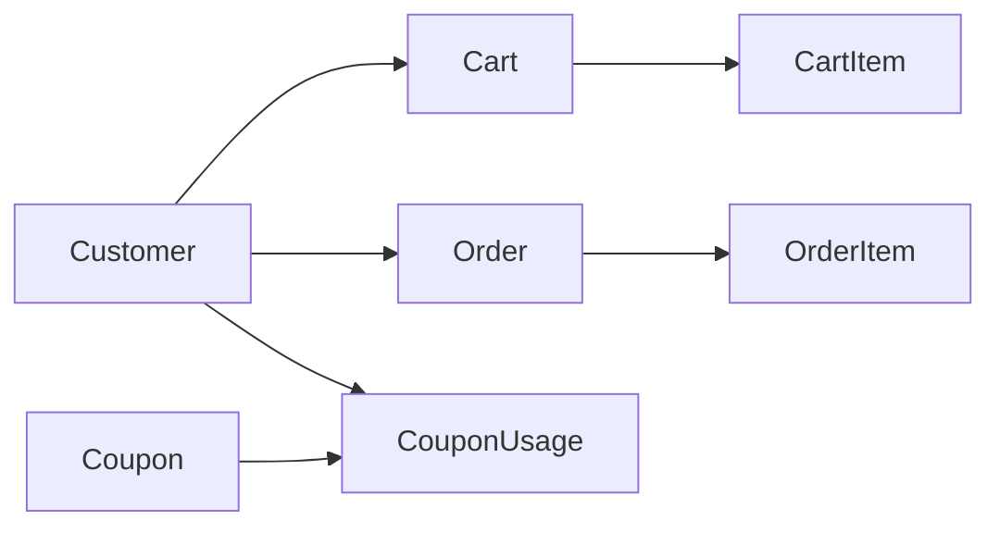
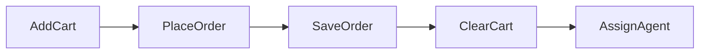

# Customer Service

Customer profile, cart, coupons, and orders. Port **8083**, MySQL database `customer`. Eureka name `CUSTOMER-SERVICE`.

## What it does

A customer adds food from one restaurant, then places an order with a coupon code. The service snapshots prices and asks Agent Service to assign a driver.

## Request & Authentication

- Gateway prefix `/api/customer`. Paths here: `/customer`, `/cart`, `/orders`, `/coupons`.
- No Spring Security in this service. Gateway allows `CUSTOMER` or `ADMIN`, except public `POST /customer`.
- Cart, “my orders”, and order placement call `JwtService.extractEmail()` and load `Customer` by that email.
- `GET /orders/all`, `GET /orders/id`, and `PATCH /orders/delivered` do **not** check who is calling.
- Auth Service creates the profile with `POST /customer` (email, userId, phone, address).

## Service Communication

Load-balanced `RestClient`:

- Restaurant: food item, restaurant by id, restaurant by food id
- Agent: `POST /agent/assign-order?id=`
- Admin reads `GET /orders/all`. Agent reads `GET /orders/id`.

## Entity Map

`CartItem` and `OrderItem` store `foodItemId` only. `Cart` stores `restaurantId`.

## Flow Diagram

