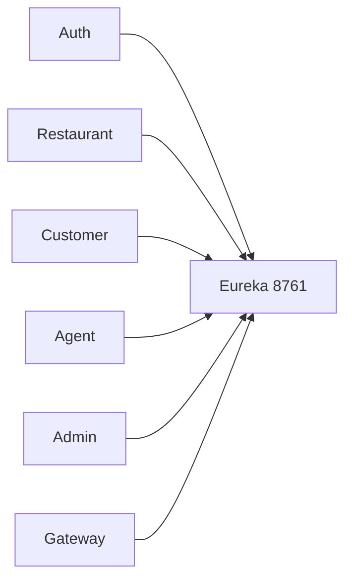

# Eureka Server

Registry only. It stores no business data.

## What it does

Runs Netflix Eureka on port **8761**. Every other service registers here so they can call each other by service name.

## Service Communication

- Clients: Gateway, Auth, Restaurant, Customer, Agent, Admin.
- They point `eureka.client.service-url.defaultZone` at `http://localhost:8761/eureka/`.
- Spring registers each app under its uppercase name, for example `CUSTOMER-SERVICE`.
- The Gateway still routes with fixed `localhost` URLs. Eureka is used by `RestClient`, not by Gateway routes.

## Entity Map

No database and no entities.

