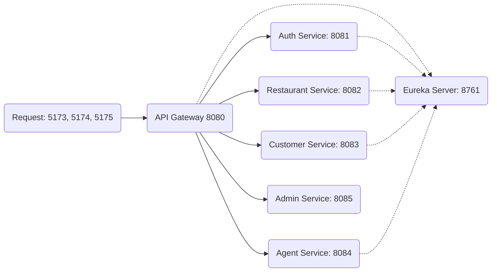
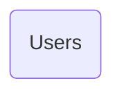
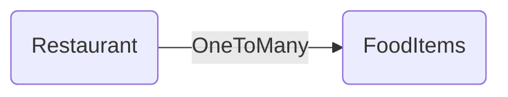
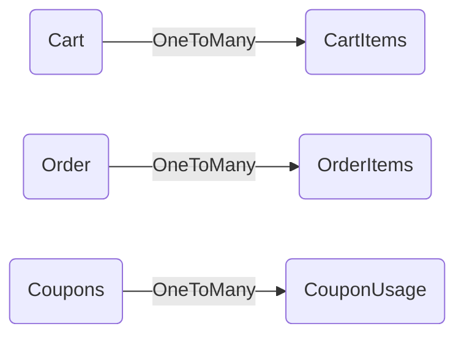
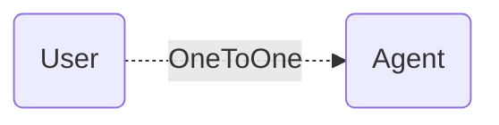
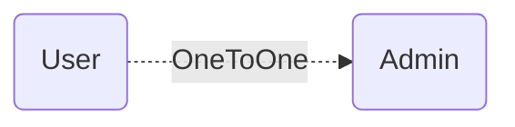

BACKEND COMPONENTS:

- Eureka Server: 8761
- API GateWay: 8080
- Auth Service: 8081
- Restaurant Service: 8082
- Customer Service: 8083
- Agent Service: 8084
- Admin Service: 8085

Here is the connection established between all the components:

Let's go with the Explanation:

Api Gateway accepts requests from 3 frontend clients (5173, 5174, 5175). Every request hits the Api Gateway itself. 
Then the request reaches to the respective service based on the request type.

Here are the responsibilities of each service routings at api gateway.

| Request Type | Reaches To |
|----|------|
| /api/auth | Auth-Service |
| /api/restaurant | Restaurant Service |
| /api/customer | Customer Service |
| /api/agent | Agent Service |
| /api/admin | Admin Service |

Example:
For Registration: http://localhost:8080/api/auth/register
For Login: http://localhost:8080/api/auth/login

Here are the Responsibilities of Each service:

1. API Gateway: 8080

API Gateway is the entry-point for each and every request. This takes the request and checks whether it is publicly accessable, protected.
If publicly accessable then it will send that directly to the respected service. 
If protected then it validates the jwt token of the request. If valid then sends that request by filtering it(removing /api/service-name). If in valid then it sends the respected unothorized response back the the user/client.

2. Auth Service:

only /api/auth/** requests will be reached to this service.

/register: This registers a new user
- If user type is customer - then it create a record and users table as well as customer table(from customer service)

- If user type is agent - then it create a record and users table as well as agent table(from agent service)

- If user type is admin - then it create a record and users table as well as admin table(from admin service)

/login: This creates a jwt token using userId, UserType, User Email.

3. /restaurant

This service consists of all the restaurants and foodItems of that restaurant.
This contains CRUD for restaurants, foodItems and where 
Get Mappings are using by publicly where was POST, PATCH, DELTE mappings are used by Admin only

4. /customer Service

This is important.
This service contains all the actions/features required for the customer who add items to cart, place order.

This Contains 4 modules

- cart-service: This contains all the cart related code/end-points/features
- order-service: This contains all the order related code/end-points/features
- coupons-service: This contains all the coupons related code/end-points/features
- common: Common code that was shared over all these services

5. /agent
Here we have agent with table containing the orders assigned to him.
Like checking assigned order, delivery order etc

6. /admin
He has access for all the other services without any restriction.
He can add new restaurants, add new foodItems to specific restaurant and check all agents and the assigned orders for them

Check all the orders. that's it.

7. Eureka Server

This server helps each server to communicate with another server without any port issues, hardcoded values.

Instead of http://localhost:8082/restaurant we just say http://RESTAURANT-SERVICE/restaurant