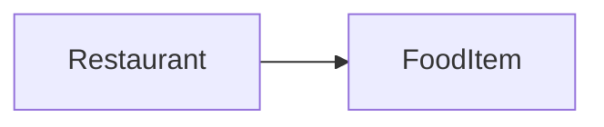
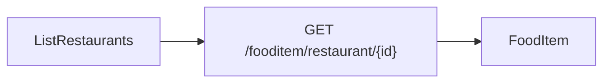

# Restaurant Service
Menu catalog. Port **8082**, MySQL database `restaurant`. Eureka name `RESTAURANT-SERVICE`.

## What it does
Stores restaurants and their food items. Other services read prices and addresses from here. It does not call anyone.

## Request & Authentication

- Gateway prefix `/api/restaurant`. After `StripPrefix=2`: `/restaurant` and `/fooditem`.
- This service has **no** Spring Security and does not read the JWT.
- At the gateway, `POST` requires `ROLE_ADMIN`. `GET` and `DELETE` are public.
- Admin Service creates and deletes by calling this service directly, not through the gateway.
- List endpoints filter and page (15 per page) by name, address, price, and availability.

## Entity Map

One restaurant has many food items. `isAvailable` is true when `quantity` is greater than 0.

## Flow Diagram

